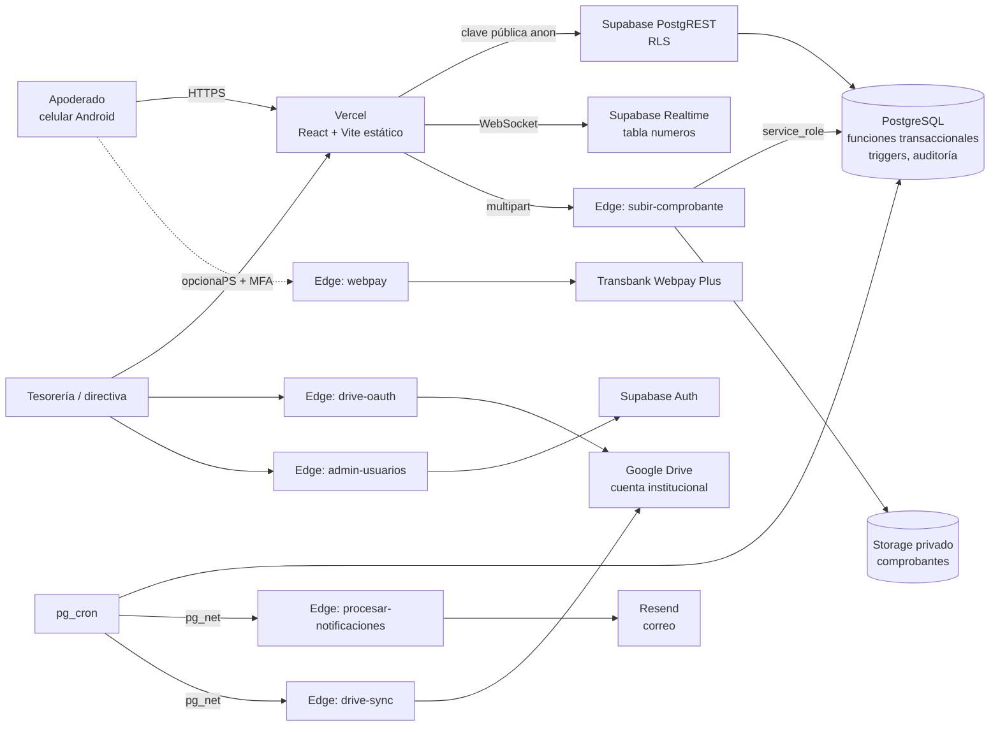
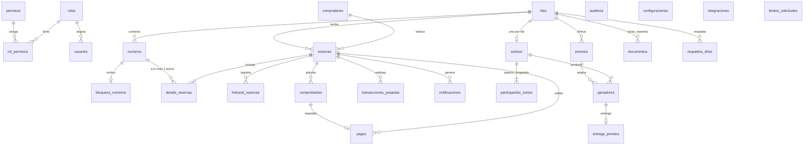
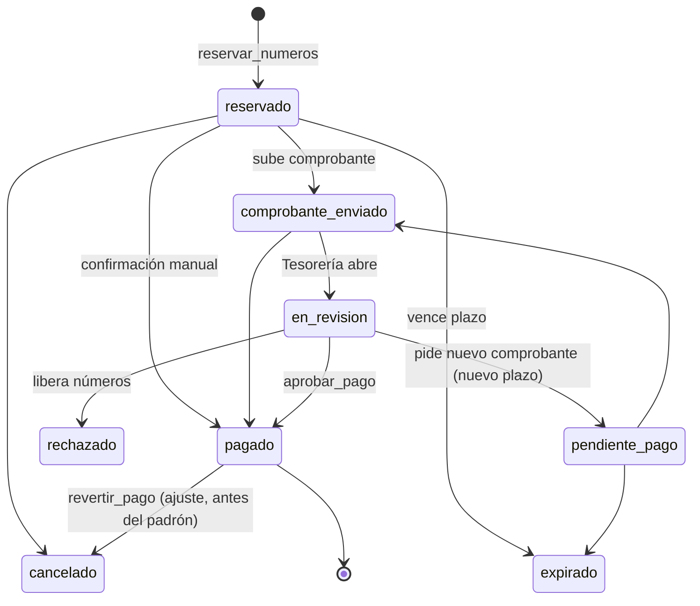

# Arquitectura — RIFA ONLINE CCPP

## 1. Visión general



**Principio:** el navegador nunca decide nada sensible. Toda regla de negocio vive en PostgreSQL
(funciones `SECURITY DEFINER` con `search_path` vacío) o en funciones Edge. El frontend sólo usa
la clave pública; la clave `service_role` existe únicamente como secreto de las funciones Edge y en Vault.

## 2. Estructura de carpetas

```
rifa-ccpp/
├─ supabase/
│  ├─ migrations/        0001…0009 (esquema, seguridad, negocio, sorteo, RLS, storage, reportes, datos iniciales, privilegios finales)
│  ├─ functions/         subir-comprobante, procesar-notificaciones, drive-oauth, drive-sync, webpay, admin-usuarios
│  │  └─ _shared/        validación de archivos, plantillas, Drive, Webpay, cifrado (+ pruebas Deno)
│  ├─ optional/cron_jobs.sql   tareas programadas (pg_cron + pg_net)
│  ├─ seed/datos_prueba.sql    datos ficticios SÓLO para desarrollo
│  └─ config.toml
├─ web/                  React + TypeScript + Vite + MUI
│  ├─ src/lib            supabase, auth, formatos CL, validación, sorteo verificable, reportes, acta
│  ├─ src/pages/publico  inicio, rifa, reserva, sorteo en vivo, verificación, privacidad
│  ├─ src/pages/admin    panel completo
│  └─ e2e/               pruebas Playwright + entorno local (PostgREST + Deno + pasarela)
├─ db-tests/             pruebas de integración de base de datos (PostgreSQL real)
├─ docs/                 manuales
└─ PROJECT_STATUS.md
```

## 3. Modelo de datos



Tablas (todas con RLS): `roles, permisos, rol_permisos, usuarios, configuraciones, rifas, premios, numeros,
bloqueos_numeros, compradores, reservas, detalle_reservas, historial_reservas, pagos, comprobantes,
transacciones_pasarela, notificaciones, sorteos, participantes_sorteo, ganadores, entrega_premios, documentos,
respaldos_drive, integraciones, auditoria, limites_solicitudes`. La semilla del sorteo vive en `interno.semillas_sorteo`
(esquema no expuesto por la API).

**Decisión clave:** la tabla `numeros` no contiene ningún dato personal ni `reserva_id`; por eso puede leerse
públicamente y transmitirse por Realtime. La relación número–reserva vive en `detalle_reservas`, privada.

## 4. Estados

Número: `disponible → reservado → pendiente_pago (comprobante en revisión) → vendido`; `bloqueado` por administración.

Reserva (máquina de estados validada por trigger):



## 5. Reglas de negocio garantizadas por la base de datos

| Regla | Mecanismo |
|---|---|
| Un número no puede reservarse dos veces | `SELECT … FOR UPDATE` ordenado + verificación de estado + **índice único parcial** `detalle_reservas(numero_id) WHERE activo` |
| Sin interbloqueos con selecciones superpuestas | Bloqueo de filas siempre en orden ascendente |
| Reservas vencidas se liberan | `pg_cron` cada minuto **y** liberación perezosa al reservar/consultar |
| No marcar pagado sin validación autorizada | Trigger exige pago aprobado por usuario activo con `pagos.validar` (o transacción Webpay autorizada) + `CHECK` en `pagos` |
| Sin cambios destructivos con ventas iniciadas | Trigger: precio y rango inicial fijos, número final sólo se amplía |
| Sorteo inmutable | Triggers bloquean `UPDATE/DELETE` de padrón, ganadores, entregas; sorteo sólo pasa una vez a ejecutado |
| Bitácora inmutable | Trigger bloquea `UPDATE/DELETE` en `auditoria`; sin privilegios de escritura |
| Abuso de reservas | Límite por IP (hash) y por teléfono, máximo de reservas sin pagar por teléfono, máximo de números por reserva |
| Exposición accidental | Migración 0009 revoca todo y otorga lista blanca; prueba automatizada lo verifica |

## 6. Sorteo verificable (CCPP-SHA256-RS v1.0.0)

1. Al congelar: padrón ordenado → `padron_hash = SHA256("1,4,7,…")`; semilla aleatoria de 32 bytes guardada en
   esquema privado; se publica `compromiso = SHA256(semilla)`.
2. Al ejecutar: `base = SHA256(semilla|padron_hash|entropía_externa)`. Para cada lugar *k*: `h = SHA256(base|k|c)`,
   48 bits, muestreo por rechazo (sin sesgo de módulo), índice = x mod m. Sin repetidos se retira el ganador.
3. Se revela la semilla. La página `/sorteo/:id/verificar` repite el cálculo en el navegador (Web Crypto).
   La implementación SQL y la TypeScript se probaron iguales en 200 sorteos aleatorios.

La animación de la pantalla en vivo **sólo muestra** ganadores ya calculados por el servidor.

## 7. Seguridad

- RLS en todas las tablas; permisos por rol en tabla (`rol_permisos`) editable por la directiva.
- MFA TOTP obligatorio configurable (`seguridad.mfa_obligatorio`, activo por defecto): sin `aal2`, `tiene_permiso()` devuelve falso.
- Comprobantes: validación de firma binaria, MIME, extensión, doble extensión, tamaño, PDF con JavaScript/adjuntos/acciones
  (incluso ofuscado), imágenes políglotas; nombre generado por el servidor; bucket privado; URLs firmadas de 5 minutos.
- Token de Google cifrado con AES-256-GCM; alcance mínimo `drive.file`; sólo se acepta la cuenta institucional configurada.
- Encabezados: CSP estricta, HSTS, X-Frame-Options, nosniff (vercel.json).
- XSS: React escapa por defecto; plantillas de correo escapan todo valor. SQL injection: sólo consultas parametrizadas / funciones.

## 8. Servicios gratuitos y limitaciones

| Servicio | Plan | Limitación relevante |
|---|---|---|
| Supabase | Free | 500 MB BD, 1 GB Storage, **pausa tras 7 días sin actividad** (mitigado con workflow `mantener-activo`), sin backups descargables automáticos (ver manual de respaldo) |
| Vercel | Hobby | Uso no comercial; adecuado para un Centro de Padres |
| Resend | Free | ~3.000 correos/mes, 100/día; requiere dominio verificado para remitente propio |
| Google Drive | Cuenta institucional | 15 GB gratis |
| WhatsApp Cloud API | Meta | Mensajes iniciados por la empresa tienen costo por conversación según tarifas de Meta → **deshabilitado por defecto** |
| Webpay | Transbank | Requiere contrato comercial → **deshabilitado**; transferencia es la modalidad funcional |
